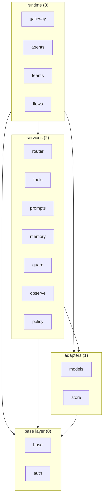

# High-level design

How the system is built to meet `10-requirements.md`. Component specs hold the detailed design of each component and
cite the section they depend on. The long form, with the file-by-file mapping, is in `.kiro/specs/0-base-structure/design.md`
while that spec exists. `<pkg>` is the import package.

## Two independent axes
- **Layer** is an import-direction rule only. It is a ceiling: the most a component may import, never a list of what it needs.
  Nothing is installed or loaded per layer.
- **Installation** is a separate classification: a component is always present or comes with its own extra. A services-layer
  component can be core (`router`) while another is optional (`memory`).
- So a user never has to install or load `memory`, `guard`, `observe`, `teams`, `flows` or any other optional component
  to use the rest. Extras are independent: one extra never pulls another.

## Layers

| Layer | Ordinal | Components |
|---|---|---|
| base | 0 | `base`, `auth` |
| adapters | 1 | `models`, `store` |
| services | 2 | `router`, `tools`, `prompts`, `memory`, `guard`, `observe`, `policy` |
| runtime | 3 | `gateway`, `agents`, `teams`, `flows` |

The arrows are the allowed direction (a ceiling), not actual dependencies; the per-component table below is tighter.

## Allowed imports (maximum per component; enforced by `tests/budget/test_import_matrix.py`)

| Component | May import | Notes |
|---|---|---|
| `base` | none (standard library only) | `base/http.py` is the one network-I/O module |
| `auth` | `base` | |
| `models`, `store` | `base`, `auth` | |
| `router` | `base`, `models`, `store` | |
| `tools` | `base`, `auth` | never `prompts` |
| `prompts` | `base` | |
| `memory` | `base`, `store`, `auth` | |
| `guard`, `observe` | `base` | `guard` may use `models` for decision pre-flight |
| `policy` | `base`, `models` | implements the authorizer Port |
| `gateway` | `base`, `tools`, `models`, `auth` | never `policy`, `guard`, `observe`, `memory`, `prompts` |
| `agents` | `base`, `models` | `tools`, `prompts` only when the matching hook is on; never `teams`, `flows` |
| `teams`, `flows` | `base` | `prompts` only when enabled; never `models`, `agents`, each other, nor the four optional services |

Three checks run on every import: no upward import; no import outside the component's set; no import among `agents`, `teams`, `flows`.

## Installation

| Class | Components |
|---|---|
| Core, standard library only | `base` |
| Optional, own extra | `auth` (`rsa`), `models` (only where no stdlib path exists, such as `google`), `store`, `memory`, `observe`, `mcp` (`fastmcp` for the MCP client), `teams`, `flows` |
| Shipped with the core, pure Python, no extra | `router`, `tools`, `prompts`, `guard`, `policy`, `gateway`, `agents` |

## Components
| Component | Layer | Role | Ports consumed |
|---|---|---|---|
| `base` | 0 | core models, errors, configuration, all Ports, `missing_extra` helper, `http.py`, the `.skye` language in `base/dsl` (text in, syntax tree out; comments, front matter, the formatter and the prompt help are text functions) | none (standard library only) |
| `auth` | 0 | strategies, credential sources, token cache, SigV4 | implements `authentication` |
| `models` | 1 | adapters for language, embedding and decision models; shared transport, retry, error mapping, token counting; implements `runnable` | `model`, `decision`, `vector_encoder`, `registry`, `cost_calculator`, `error_handler`, `token_counter`, `runnable`; credentials through `auth` |
| `store` | 1 | in-memory, file, DynamoDB, Redis backends | `storage`; credentials through `auth` |
| `router` | 2 | ModelRouter, strategies (cost based included, D68), health tracking, fallbacks | `router`, `model`, `decision`, `registry`, `storage` |
| `tools` | 2 | capability registry, local functions, remote API, MCP client (implements the `resource` Port of `base`) | `capability`, `registry`, `resource`, `prompt` and the `base` messages for the MCP prompt facet; credentials through `auth` |
| `prompts` | 2 | loaders, role-based messages, the `.skye` renderer, bundled prompts (all `.skye`), output instructions, prompt help | `prompt`, `content_reader` |
| `memory` | 2 | conversation and state memory | `memory`, `storage`; credentials through `auth` |
| `guard` | 2 | safety filters, pre-flight checks | `safety`, `decision` |
| `observe` | 2 | events, logs, metrics, traces | `observer`, `event_handler` |
| `policy` | 2 | policy decisions; implements `authorizer` | `authorizer`; optionally `decision` |
| `gateway` | 3 | the library acting as an MCP server, toolset per operation | `capability`; optionally `decision`; optional services by injection |
| `agents` | 3 | agent loop (`AgentLoop`, D90), `Agent`, hooks, agent-type registry | `runnable`, `model`; per enabled hook `capability`, `prompt`; optional services by injection |
| `teams` | 3 | coordinate units toward a shared objective; owns the team-role concept | `runnable` only; optionally `prompt` |
| `flows` | 3 | sequence units into steps; reads a `flow` block of a `.skye` file and runs it | `runnable` only; optionally `prompt` |

## Ports (all in `base/interfaces`)
`model`, `decision`, `runnable`, `storage`, `registry`, `cost_calculator`, `error_handler`, `token_counter`, `memory`,
`vector_encoder`, `router`, `safety`, `observer`, `event_handler`, `content_reader`, `multimodal_handler`, `prompt`,
`config_loader`, `plugin`, `capability`, `resource`, `authorizer`, `authentication`. Every cross-component dependency crosses a Port,
never a concrete implementation. The `prompt` Port also defines the provider-agnostic prompt parts that `prompts` produces and the
model adapters translate into native request fields, so `models` never imports `prompts` (D81).

A Port is a class named `*Interface` (exceptions: `Runnable`, `DecisionModel`, `StorageBackend`) and describes the call its users
make (Requirement 16.6). Its docstring ends with a fixed footer: what it raises, what it returns when something is missing, whether
several threads or tasks may call it, and, for hooks and observers, that their exceptions are logged and swallowed (Requirement 16.8).
The compliance check compares every method by parameter names and kinds and by `def` or `async def`, for abstract bases and
`Protocol`s alike, and one test runs every built-in implementation through it (Requirement 16.7). A Port that nothing implements
and nothing tests is not exported (Requirement 16.9). The kind of a Port follows one rule (D37): a Port that third parties implement as a plain class is a
`@runtime_checkable` `Protocol` (`AuthenticationInterface`, `AuthorizerInterface`, `DecisionModel`, `Runnable`, `ObserverInterface`,
`SafetyFilterInterface`, `MemoryInterface`), so a class with the right methods satisfies it with no base class and `isinstance` works; a
Port that carries default behaviour to inherit (`ModelInterface` with `BaseModelProvider`: retry, health) stays an abstract base. A Port
that is a Protocol keeps its `@abstractmethod`s, so a class that does inherit it and misses a method still fails when instantiated.
A concrete class that cannot inherit its Port (`ConfigLoader` and `ConfigLoaderInterface`, which import each other's module) satisfies
it by structure, and a test checks the signatures.

One primitive runs a single capability call: it never raises and returns a `CapabilityMessage` whose outcome says succeeded, failed,
denied or skipped (Requirement 16.10, decision D42). It lives in `base`, beside the capability Port, so `agents`, `teams` and
`flows` call it without importing `tools`. The response methods, the executable call, the registry and the call handler all delegate to
it, so one behaviour holds on every path; `registry.execute` is the one documented exception that raises ("I called it myself"). A
runtime component reaches its toolset through one Port — list the schemas for an operation, run one call, optionally close — implemented
by the capability registry and by the gateway client, and every call carries a context (scope token, operation description) separate
from the model's arguments (Requirement 16.11, decision D44).

## Composition
`agents`, `teams`, `flows` compose each other and model adapters without importing each other, because each holds its children
as `Runnable` references received from the caller. Model adapters implement `Runnable`, so a model is a step in a flow or a
member of a team. A supervisor that picks the next member may use a decision model, again received as a `Runnable`.
Cycle detection runs at runtime (visited set, depth bound 100). Roles are membership metadata in `teams`.

## Optional services
`gateway`, `agents`, `teams`, `flows` get authorization, safety, observation and memory by injection or hooks through the
Ports `authorizer`, `safety`, `observer`, `memory`. An agent without a memory hook never imports `memory`. The gateway checks
every listing and call with the authorizer when one is provided.

## Extension points
| Kind | Port in `base` | Owner | A new one is added by |
|---|---|---|---|
| provider (model, embedding, decision) | `model`, `vector_encoder`, `decision` | `models` | `@plugins.provider("name")` on a class, with its profile |
| store backend | `storage` | `store` | `@plugins.backend("name")` on a class |
| tool | `capability` | `tools` | `@capability` on a function, passed in `tools=[...]` or put in a `CapabilityRegistry` |
| toolkit | `tool_provider` | `tools` | `@plugins.toolkit("name")` on a class that extends `skye.Toolkit` |
| observability exporter | `observer` | `observe` | registering it in the observe registry |
| credential provider | credential-source Port | `auth` | `@plugins.credential_source("name")` on a class |

Adding one never edits a file outside the owner; a check rejects it otherwise. Every kind is also reachable through a plugin (next section).

## Plugins and provider profiles
Decision D111 (Requirements 56 to 62); the spec is `0-base-plugins`. One entry for every kind: an object `plugins = skye.Plugins()`, created
anywhere, whose methods are decorators (or direct calls) that register at the moment they run, from any part of the program. There is no
plugin object with `register(registrar)`, no `PluginInterface` and no `skye.use`. The kinds are `provider`, `backend`,
`credential_source`, `routing_strategy`, `mcp_client`, `tokenizer`, `template_filter`, `agent` and `toolkit`. The same word adds and builds:
`plugins.agent("reverse")` and `skye.agent("reverse")`, `plugins.provider` and `skye.provider`, and so on.
- **The handle and the registrar.** `Plugins` is a thin handle on the one default table of the process; every handle sees the same
  registrations. The concrete `Registrar` stays for a private table (a test) and has `unregister`; a duplicate raises unless `replace=True`.
  A registration is in memory for the running process only, and the write is safe from several threads. There is no namespace of
  plugins and no scope for tests (D111).
- **One kind, several functions.** `provider` covers models, embeddings and decisions. The table is keyed by name and function, and the
  function is deduced from the method of the class (`generate`, `encode`, `decide`); `skye.provider(name)` builds a model provider and
  `provider_type="embedding"` or `"decision"` the others. One provider name has one profile, kept under its own name.
- **Sync and async.** A plugin writes only the async method; `run_sync` and `iterate_sync` in `base` derive the sync one.
- **Where.** `RegistrarInterface`, `ProviderProfile`, `ModelProfile`, `RegionRule`, `resolve_region` and the lookup of
  a `ModelProfile` are in `base` (data, Protocols and in-memory tables; no I/O). The scan of the entry-point group `skye.plugins` is
  I/O and is outside `base` (`skye.utils.plugins:discover`, held in `base` as text); a lookup that finds no name triggers it once,
  lazily. The value of an entry point is a module, and importing it runs its decorators. `import <pkg>` never scans.
- **Built-ins use the same calls.** The built-in providers, backends, strategies, MCP clients and toolkits register with the same
  calls, by `"module:attribute"` text so that nothing is imported before first use. The registries that exist today stay as views;
  the capability registry is not one of them.
- **Layout of the built-ins (D110).** Each extensible component keeps them in `<component>/plugins/<name>/`, one folder per implementation or
  provider (`models`: `openai`, `anthropic`, `bedrock`, `azure`, `google`, `cohere`, `typesafe`; `store`, `auth` and `tools` by implementation).
  The `__init__.py` of a folder is the only door: public names resolved lazily, and an internal `register(registrar)` that makes the same calls as a third party.
  The files have the same names in every folder: in `models` `provider.py`, `request.py`, `response.py`, `capabilities.py`, `embeddings.py`,
  `multimodal_embeddings.py`, `decision.py`, `profile.toml`; the main file is `backend.py` in `store`, `source.py` in `auth`, `client.py` in `tools` and `agent.py` in `agents`. What several providers use, and what a plugin is written with, is in
  `models/utilities/` (`base.py`, `openai_compatible/`, `anthropic_compatible/`, `transport/`), not in `plugins/`. `plugins` is not a component: it would have to know the internal paths of all
  the others (Requirement 56.9).
- **The profile is the one home of provider knowledge.** It carries the key variable, the region rule, the default endpoint, the client
  settings (Azure's names), the model profiles (prices, tokenizer, message overhead, `get_model_info` keys) and the error mapper. Cost,
  token counting, the router and `auth` read it; none keeps a table of provider names. Logic stays in the adapter module (error
  handler, schema conversion); the profile points to it. The profiles of the built-in providers are data, one `profile.toml` per provider
  read with the standard library; `base` only builds the dataclass from the mapping (`profile_from_mapping`), because it does no file I/O.
- **The store keeps its own representation.** `CounterStore.count`, a capability for liveness and remaining lifetime, and the default
  backend created by `skye.store.backend("memory")` mean that the router never reads a stored shape or compares a timestamp with the clock.
- **Control.** Optional allowlist `plugins` in the configuration file; `skye plugins` lists
  what is installed and registered. Conformance: one public `check_<kind>` per kind, run over the built-ins too.
- **Tools, toolkits and agents (D111).** Capabilities are not a plugin kind and no default set exists: a tool belongs to the agent that is
  given it. `@capability` (required) takes `name`, `description` and `return_direct`; a `CapabilityRegistry` stays in `tools` and holds
  tools with namespaces (`weather.get_current`). The built-in tools are toolkits, `ToolProvider`s that an agent takes in `toolkits=`,
  apart from its own `tools=`: `files` (a required root), `openapi`, `mcp`, `a2a`. A toolkit is a class that extends `skye.Toolkit`
  with `@capability` on its methods; the name of a tool is `<toolkit>.<name>`. A `SKILL.md` in `skills=` adds `files` by itself,
  limited to the folder of the skill. An agent is built only with `skye.agent(name, **options)`; `REACT` is the built-in one.
- **Tokenizers.** A tokenizer is registered by name and a model uses it through its `ModelProfile`; `plugins.profile(provider, models=...)`
  merges a change into an existing provider.
- **Checks.** `tests/budget/test_provider_knowledge.py` and `tests/budget/test_storage_knowledge.py` (allowlists that only shrink);
  the cold-start and size budgets do not rise.

## Base contracts
`base` holds the shapes every component shares. Message types: `SkyeMessage` with the role variants (`UserMessage`, `AssistantMessage`,
`SystemMessage`, `CapabilityMessage`) and `ContentChunk`. Completion: `CompleteRequest` and `CompleteResponse` (content, role,
metadata, token usage, model identifier, provider; streaming yields chunks in one format). The capability schema (name, description,
parameters) is a pure contract in `base`; handlers and the registry stay in `tools`. Errors: `SkyeError` with `ProviderError`
(provider context, status), `ConfigurationError`, `ValidationError` (field and value), `CapabilityExecutionError` and `MissingExtraError`;
wrapped errors keep the original message and stack. Configuration sources, in priority order: code, environment, file (JSON in version 1, D92; a `.skye` form is open decision O48; no YAML, D62);
`${VAR}` is substituted in JSON and `env.NAME` is the form in `.skye`; invalid values raise `ConfigurationError`. The Ports are listed in "Ports"; each performs no I/O.

## Public API and lazy imports
A user-facing path has at most two levels and never goes through `<pkg>.base` or into a module inside a component (Requirement 7.14, D34).
The public paths are thin facades that only re-export `base` (Requirement 7.15): `<pkg>` (the commonest names, resolved lazily),
`<pkg>.interfaces` (every Port), `<pkg>.data` (`Validated`, `validated`, `field`), `<pkg>.dsl` (`check_text`, `format_text`,
`describe`, `to_mermaid`; D78, D83, D88), `<pkg>.messages`, `<pkg>.completion`,
`<pkg>.exceptions`, `<pkg>.config`; each component package exports what its users need. All of it is standard-library only, so
`import <pkg>` never reaches an optional or provider library (Requirement 7.4, 7.8). `tests/budget/test_public_imports.py` scans the
examples, the documentation and the `README.md`.

A name a user of the OpenAI SDK, LiteLLM or Pydantic would try may be added as a thin alias that stores no second value (Requirement
22.7, decision D39); a test records each such name as `exists` or `known_missing` and the missing list only shrinks. A verbose
configuration object may offer one shorthand on its existing constructor that builds the same objects and hides none of the full form,
with one syntax and no second constructor (Requirement 22.8): the router takes `{"alias": ["provider/model", ...]}` and builds the same
`RouteConfig`, `ModelTarget` and `FallbackConfig`. `provider(name, **config)` is typed so the common call type-checks with no cast
(Requirement 22.9). None of these is copied from the reference library; an API shape is a design choice, source and docstrings are not
(see `CONTRIBUTING.md`). Lazy loading uses the standard library
(`importlib`, module `__getattr__`) plus one thin helper in `base` that imports at first use and raises `MissingExtraError`
(wrapping the `ImportError`, naming the extra). Each optional component imports its heavy library inside the function that first
needs it. A breaking rename is acceptable while the version is 0.x and the migration is documented.

## The `.skye` language
One declarative language, HCL-like, written from scratch in the standard library, for the `router`, `flow` and `prompt` blocks (Requirement
54, D50). A file holds one or more blocks; each file is self-sufficient, with no `include` in version 1.

Where it lives. The parser is in `base` and takes **text**, never a path, because `base` does no file I/O (Requirement 3.2); it returns a
neutral syntax tree. The component that owns a block reads the file, calls the parser and validates the tree into its own dataclasses: the
`router` component into the router configuration, `flows` into a flow, `prompts` into a prompt (D50, D61). The loaders are
`Flow.from_file(path, name=..., registry=...)`, `Router.from_file(path, name=...)` and `skye.load(path)`, which returns every block of the
file. `flows` still imports only `base`: a step is a `Runnable` resolved by name from a registry the caller passes (D52), never by import.

What the loader checks before anything runs (Requirement 54.4): every `next`, `on_error`, `on_timeout` and `fallback` names a block that
exists, every step has a `next`, a `choice` has an `else`, a step that can be re-entered has `max_visits`, every reference has a known
prefix and resolves, every context field is declared and typed, every duration is a string with a unit. Errors carry the file, line,
column, reason and the fix, and all errors of a file are reported together (54.3). Expressions are restricted to comparison, `and`/`or`/`not`,
arithmetic, `in` and a fixed list of functions, checked with `ast` and never evaluated with `eval` or `exec` (54.5, D55); one expression
grammar in `base` serves the flow guards and the prompt interpolation.

Scope. Version 1: routers, flows (sequence, conditions, parallel, bounded loops, retry, timeout, errors, `foreach`) and the reduced `prompt`
block that replaces the 18 bundled `.jinja` templates, checked by an equivalence test (D51, D60). Version 2, written but not built: waiting for
events with persistence and resume (`wait`, `on_event`; version 1 reserves both words and rejects them with a clear message; at-least-once
with an idempotency key per step, D87), `include`, and in prompts the examples, multimodal content and `bind` (the prompt `output` block moved to version 1 by D70). Tools of version 1: the written grammar, a JSON Schema of
the blocks, `skye check <file>` (D61) and `skye render` with `to_mermaid()` for flows and routers (D88, moved from version 2). JSON router files stay readable; YAML is not read (D59, D62). The language adds no third-party library
to any component (D49).

Text-level features (all in `base/dsl`, text in and text out, no file I/O). **Comments** (D71): `#` to the end of the line, `/* */` and `/** **/`
over lines without nesting; `//` is floor division, not a comment; inside an expression a comment is a space. **Front matter** (D71):
metadata between two `---` lines at the top of the file, written in TOML and read with `tomllib` (never YAML, D62), kept in
`Document.metadata` and written back by `to_text`; the module is `metadata.py`, because `front` is a watermark (R4). **`skye fmt`** (D71):
`format_text` works on the text, not on the model, so comments, `"""` strings and front matter survive; it refuses a file with errors and a
result that would build a different model, is idempotent, and is the same function behind `--check` and `-` (editors). **`skye check
--format json`** with `-` and `--stdin-filename` (D72) gives an editor the diagnostics the command line gives CI.

Prompt features of the language. Variables are described and typed with the syntax of `output` fields (D73): a trailing string is the
description, and `list(string)`, `list({ ... }, [])`, `map({ ... })` and nesting give a structured type that `render_prompt` checks with
one `ValidationError` listing every path (`shapes.py`, `conform`); the default of a structured variable is the second argument (D83). `each` has one variable and `loop.*` (D69). The `output` block (`json`, `table`, `xml`, `schema = VAR`, a format from a
`string` variable, conditional variants inside `when`) turns one declaration into the instructions for the model (D70, in `prompts`).
`describe(spec)` in `base/dsl/info.py` describes any block (prompt, router, flow; D83), public in `skye.dsl` with `check_text` and
`format_text` (D78); `skye.prompts` re-exports `describe_prompt` / `prompt_help`. They tell what a prompt takes and gives back, and `skye prompt list|info` print it (D73). The bundled prompts are all `.skye`,
with front matter, structured inputs, one shape for `tools` and the five memories, tool parameters as JSON Schema (D80), and a usage
comment a test renders (D74). Text templates do interpolation only; `` tags are rejected (D76). A rendered prompt is also available as
provider-agnostic parts, a type of a Port in `base` that the model adapters translate to native fields (D81).

Editors (D72). A VS Code extension ships inside the package (`utils/vscode_extension/`, plain JavaScript, no npm dependency, no build):
a TextMate grammar, diagnostics from `skye check --format json` and "Format Document" through `skye fmt -`; it is only a client of the
command line. `skye vscode install|uninstall|status|path|package` (`utils/vscode.py`) builds a `.vsix` with `zipfile` for an editor CLI,
or copies the folder into `~/.vscode/extensions` (Requirement 55).

## Transport and providers
What a provider is written with is in `models/utilities/` (D110), as plain modules: the network (`rest.py` JSON over `urllib` and server-sent events,
`streaming.py` parsing of `text/event-stream`, `eventstream.py` the Bedrock framing, `retry.py` with 3 retries after the first attempt,
`error_mapping.py`; the HTTP helper itself is `base/http.py`), the shaping of a request (`structured.py`, `schema_check.py`,
`capability_choice.py`, `prompt_parts.py`, `multimodal.py`) and `credentials.py`; `models/base.py`, `cost.py` and `token_counter.py` are the
component's own. SigV4 signing is in `auth` and reused by Bedrock. Three adapter
families (`models/utilities/openai_compatible`, `models/utilities/anthropic_compatible`, and the provider folders of `models/plugins`): `openai_compatible` (one adapter keyed by base URL and key, with `openai` and `azure` holding what is specific to each: OpenAI, Azure and
the OpenAI-compatible ecosystem), `anthropic` (Messages API), `bedrock` (Converse with SigV4, boto3 not required); Google has its own
dialect. Streaming parsing and signing are written once and reused. The provider-SDK extras are driven to zero; the residual extras
are `memory`, `observe` if no stdlib path exists, `mcp` and `auth`.
Adapters expose `invoke` (the `Runnable` Port) and delegate to `acomplete`; vendor SDKs appear only in `tests/differential`. Where an external type exists it is converted once, inside the owner (Requirement 9.5).

## Store layout
| Backend | Module | Capabilities | Extra | Driver |
|---|---|---|---|---|
| in-memory | `store/plugins/memory/backend.py` | key-value, counter, scan | none (default, D97) | standard library |
| file | `store/plugins/file/backend.py` | key-value, counter, scan | none | standard library |
| DynamoDB | `store/plugins/dynamodb/backend.py` | key-value, counter, scan | `aws` (only outside Lambda) | boto3 |
| Redis / Valkey | `store/plugins/redis/backend.py` | key-value, counter, scan | `valkey` or `redis` | valkey-py, else redis-py (D102) |
| PostgreSQL | `store/plugins/postgres/backend.py` | key-value, counter, scan | none (Data API), `postgres` (pg8000), `postgres-asyncpg` | RDS Data API through boto3, then pg8000, then asyncpg (D100) |
| durable function | `store/plugins/durable_function/backend.py` | key-value, counter | none | the caller's durable context |
Each backend is a separate module reached only through the storage Ports (`KeyValueStore`, `CounterStore`, `ScanStore`; D98), created
with `skye.store.backend(name, **config)` or directly, and checked by the public conformance suite. The default is in-memory; a durable
backend is always chosen by the caller (D97).

## DecisionModel (Jev)
`base/interfaces/decision.py` defines the one `DecisionModel` Port: a finite option set in, one choice and a probability per option out
(each in 0..1, sum 1, empty set rejected). The implementation, Jev, is `models/plugins/typesafe/decision.py`. Consumers: `gateway` (tool selection),
`router` (cheapest capable model), `guard` (pre-flight).

## Extras and budgets (table)
| Component | Extra | Third-party libraries |
|---|---|---|
| models | none | none (standard library REST); `google` declares only its SDK |
| tools | none | none |
| tools (MCP client) | `mcp` | `fastmcp` |
| auth | `auth` | `rsa` |
| memory | `memory` | `redis`, `asyncpg` |
| observe | `observe` | only if no stdlib path exists |
| teams, flows | `teams`, `flows` | none; both in `known_empty` |

`budgets.toml` holds `max_modules_loaded`, `max_import_ms`, `forbidden_at_import`, the allowed dependencies, and one entry per extra
(`[extras.<name>]`, with `known_empty` for extras that declare nothing). The suite in `tests/budget` and `.github/workflows/budgets.yml`
enforce them; `make budget-fast`, `make budget` and `make differential` run them locally.

## Auth component
Layer 0, next to `base` but separate: `base` does no I/O (apart from `base/http.py`), `auth` calls metadata and token endpoints, reads
credential files, may run a subprocess and needs `rsa`. The authentication Port is in `base`; `auth` supplies strategies (API key and
bearer, SigV4, OAuth2), credential sources (environment, files, container credentials, IMDSv2, token exchange, metadata server, secret
managers over `base/http.py`), an extensible credential-source Port and a token cache. Tiers for the order of work: A (no network),
B (an HTTP exchange or metadata call), C (RSA, a subprocess, vendor-format files). The modes to verify are listed in Requirement 11.9.
Tests use fake credential endpoints (stdlib `http.server`, as in `tests/differential/fake_mcp_server.py`).

## MCP client
Lives in `tools`, consume-only. Official MCP types are converted at one module (`tools/mcp_boundary.py`); the prompt facet returns `base`
messages through the `MCPPrompt` descriptor in `tools`; `Resource` stays internal to `tools` until a same-layer consumer needs it
(then a resource Port in `base`, open decision O7). The built-in client is JSON-RPC over stateless HTTP on `base/http.py`; `fastmcp`
is the optional substitute (`create_mcp_client(target, impl=...)`); differential tests keep both equal.
Only `tools/plugins/fastmcp/client.py` imports `fastmcp`; the built-in client is the default and `impl="fastmcp"` returns the substitute from the `mcp` extra.

## Correctness properties (what the tests guard)
1. Layer import direction is downward only. 2. Imports stay within each component's allowed set. 3. `base` imports only the standard library.
4. A clean top-level import pulls no forbidden library. 5. Extras declare exactly the imported libraries. 6. Codename invariants hold.
7. A store backend lives in exactly one place. 8. An absent extra raises `MissingExtraError`. 9. `DecisionModel` probabilities are
well-formed. 10. The transport and the adapters import no provider SDK or third-party HTTP client. 11. No import edge among
`agents`, `teams`, `flows`. 12. `teams` and `flows` import neither `models` nor an orchestrator. 13. An added integration stays inside its owner. 14. Examples, documentation and `README.md` import only from the public paths.
15. No public class name is defined twice. 16. Every built-in implementation conforms to its Port by signature. 17. Every example runs
offline, exits 0 and ends in no traceback, and every install line names a real extra. 18. The first docstring of the package and of
each Port runs. 19. Every execution path returns the same `CapabilityMessage` for the same call, and a tool's own `"Error:"` text is not
marked as a failure. 20. A guessable-name alias stores no second value, and the known-missing list only shrinks.
21. The `.skye` parser imports only the standard library, takes text and never a path. 22. Every load error names the file, line and column.
23. No `.skye` expression is evaluated with `eval` or `exec`, and one that calls anything outside the allowed list is rejected.
24. A loop over steps is bounded, and a flow that can run forever does not load. 25. Every `.skye` example in the documentation passes
`skye check`, and the examples of the language pass the parser.

## Codename placement

| Component | Codename | Component | Codename |
|---|---|---|---|
| base | stratus | memory | dew |
| auth | ozone | guard | halo |
| models | zephyr | policy | isobar |
| store | lake | observe | radar |
| router | jet | gateway | horizon |
| tools | updraft | agents | cyclone |
| prompts | cirrus | teams, flows | front, stream |

Front matter of the spec and the docs section; one italic line under the section index title; last line of the package docstring;
`docs/project/glossary.md`. Nowhere else (R8).

## Testing
Deterministic checks guard the architecture: the import matrix, the codename test, the extras footprint test, the clean-import test,
the steering test, the no-old-name test, the public-imports test, and the differential tests. The public surface adds the Port
conformance test, the duplicate-name test, the example-quality tests (offline run, size, README against folder, install lines) and the
docstring test (properties 14 to 18). The `.skye` language adds a conformance suite built from its reference examples and from the table of
load-time errors, and the `skye check` run over the documentation (properties 21 to 25). A requirement that has no test names the reason.
