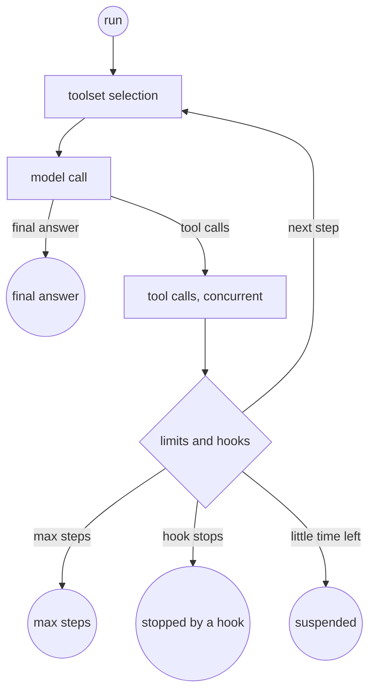

# Agents (preview)

This page lets you see how the agent loop of Skye is designed, so you can plan for it. It describes a design, not code you can use.

!!! warning "Not released"
    The agent loop, `AgentLoop`, `Agent`, the hooks, the checkpoints and everything else on this page are **not built yet**. Names
    and defaults can still change. Track progress on [Status and roadmap](../project/roadmap.md).

    This page was written before the plugin interface. Today an agent is built with `skye.agent(name, **options)`, there is no `Agent`
    class, and the built-in agent is `REACT` from `skye.agents` (its loop is not written yet). The hooks and the checkpoints below stay the
    plan; the class names do not.

## Two classes

- **`AgentLoop`** is the bare loop. It takes a model (or a router), a tool provider, optional memory and optional hook providers,
  and runs steps until the model gives a final answer.
- **`Agent`** is `AgentLoop` plus five default hook providers: limits, safety, policy, observability and checkpointing. It is the class
  you will use and subclass.

The bare loop has no `Base` prefix on purpose. Subclassing the bare loop would silently drop safety, policy and cost limits, so the
name points you to `Agent` instead.

`agents` sits in the runtime layer and ships with the core, with no extra. It imports only `base` and `models`. It never imports
`policy`, `guard`, `observe` or `memory`: they arrive through their Ports (see [Architecture](architecture.md)). It implements
`Runnable`, so an agent can be a step in a flow or a member of a team.

## The loop

A run is a sequence of steps. A step asks for the toolset, calls the model, runs the tools the model asked for and feeds the
results back. The run ends for exactly one reason, which the result reports:

## Nine operations, each with hooks

The loop names nine operations in one enumeration, so you register a hook by name:

| Operation | What happens |
|---|---|
| `run` | the whole run |
| `step` | one cycle of the loop |
| `toolset` | the tool provider is asked for the tools of this step |
| `model_call` | the model (or the router) is called |
| `tool_call` | one tool runs |
| `memory_read` | memory is read |
| `memory_write` | memory is written |
| `safety` | the safety filter checks text |
| `policy` | the authorizer checks an action |

Every operation has a **pre** hook point, a **post** hook point and an **error** hook point. A hook receives the agent state, the
operation name and the payload: the request before, the result after.

| Hook | Possible outcomes |
|---|---|
| pre | continue; continue with a modified payload; skip the operation and supply its result; deny with a reason |
| post | keep the result; replace it; retry with a modified payload (within the retry limit); stop the run |

- Pre hooks run in registration order, post hooks in reverse.
- A hook may be a function or a coroutine function.
- When a hook raises, its setting decides: **fail closed** (stop the operation) for hooks that protect (safety, policy, limits),
  **fail open** (log and continue) for observers.
- You customize in three ways, in this order: override the method of a hook point in a subclass, register hooks on an instance, or
  pass hook providers that register several hooks together. A hook can be limited to some tools or models, by name or tag.
- Event handlers are observers: their errors never stop the run and they cannot change a payload.

## Defaults

All of these are constructor arguments:

| Setting | Default |
|---|---|
| Maximum steps | 20 |
| Retries per operation | 2 (3 attempts) |
| Time limit per hook | 5 seconds |
| Consecutive failed steps before the run stops | 3 |
| Streaming checkpoint window | 500 characters |
| Checkpointing | off |

The limits provider is on by default. The safety and policy providers turn on by themselves when you configure a safety filter or an
authorizer. `Agent` lists its active hooks in execution order, so nothing is hidden.

Tool failures go back to the model so it can correct itself: invalid arguments, an exception in the tool, a timeout and a policy
denial all return as a `CapabilityMessage` with an error status. An exceeded limit (steps, tokens, cost, time) or a configuration or
credentials error stops the run. A hook can change either outcome.

## Streaming with checkpoints

Checking every chunk of a streamed answer costs too much; checking only the complete answer is too late, because the text is
already on screen. The loop buffers the text and runs the safety and policy hooks at checkpoints: every window of 500 characters on
all the text so far, and once more on the complete answer.

- **hold** (default): a window reaches you only after its checkpoint passed. Nothing blocked is ever shown; the delay is at most one
  window.
- **show and retract**: text is sent at once, and a failed checkpoint emits a `retract` event so your interface removes what it showed.

An `on_chunk` observer sees every chunk and cannot change it.

## Suspend and resume

A run must survive the end of a Lambda invocation:

- The whole run lives in an `AgentState` that serializes to JSON with the standard library.
- When you turn checkpointing on, the state is saved through the storage Port, after each step by default. It is off unless you turn
  it on, in Lambda too, even when you pass a store.
- You pass a function that returns the remaining time (the Lambda context, or any deadline). When the time left drops below a margin,
  the loop stops before the next step and returns a `Suspended` result with the checkpoint identifier.
- Given that identifier, a later invocation resumes the run from the saved state.

The loop uses no multiprocessing and starts nothing that continues after the run returns. Several tool calls in one step run
concurrently, up to a limit, and their results come back in the order the model asked for them. Tokens and cost are counted per run
and returned in the result.

## Decided directions

Two features are decided; how they are built is still open.

**Infinite context.** Summarizing and windowing the history keeps the request under the context window, but loses details. In this
mode, the messages that compaction removes are archived, not deleted, and indexed. The agent can recall them by search, so something
said at step 3 can come back word for word at step 40. The summary keeps a marker of the archived range so the model knows it can
ask. Still open: what is archived, where the archive lives, how recall is triggered, and whether the mode is on by default.

**Tools written by the agent.** During a run, the agent can create a capability, register it and use it in later steps or later
runs. The forms range from the safest (a `.skye` flow that composes existing tools, a prompt-backed tool, an HTTP tool) to Python
code, which would never run inside the agent's process. A written tool goes through validation, tests, approval and registration,
can never call more than its author may, and every call records the version that ran. Still open: which forms are allowed, the
approval, the scope, the limits and whether the feature is on by default.

## See also

- [Status and roadmap](../project/roadmap.md): what is released and what is planned.
- [Architecture](architecture.md): the runtime layer, `Runnable` and optional services through Ports.
- [Serverless first](serverless-first.md): why the loop starts no background work and keeps state outside the process.
