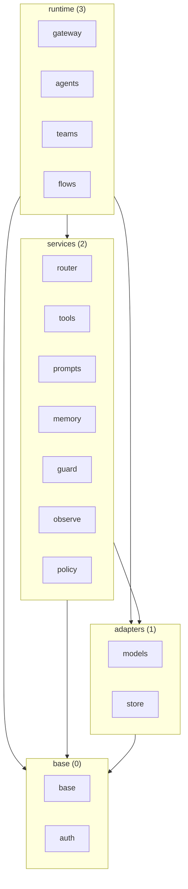
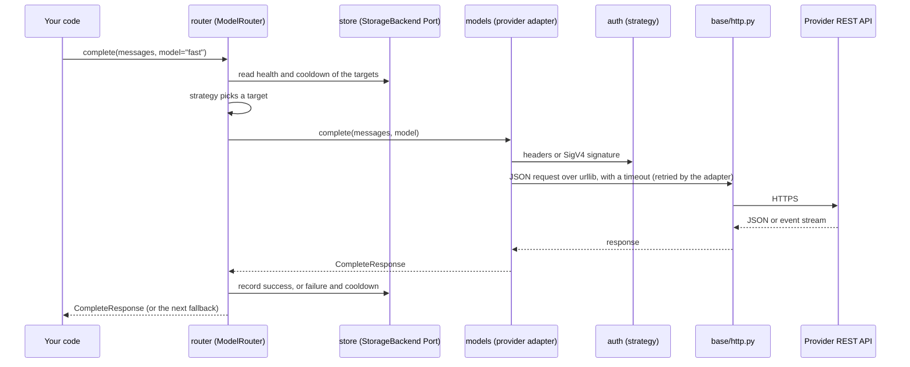
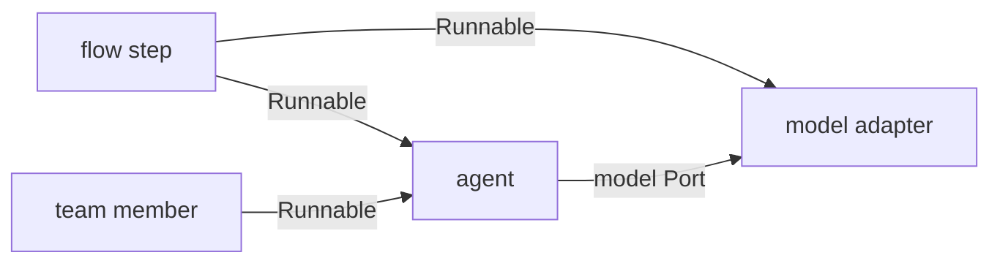

# Architecture

This page shows you how Skye is put together: four layers, fifteen components, the Ports that connect them and the import rules
that keep them apart. Read it before you extend Skye or wonder where a feature belongs.

## Fifteen components in four layers

Skye is one package, `skyeai`, imported as `skye`. Inside it there are exactly fifteen components. Each one has a short name that is
also its package (`skye.router`), its spec folder and its entry in `budgets.toml`.

| Layer | Ordinal | Components | What they do |
|---|---|---|---|
| base | 0 | `base`, `auth` | Messages, completion types, errors, configuration, every Port, the `.skye` parser, the one HTTP helper; credentials and request signing |
| adapters | 1 | `models`, `store` | Provider adapters for language, embedding and decision models; state backends |
| services | 2 | `router`, `tools`, `prompts`, `memory`, `guard`, `observe`, `policy` | Routing and fallbacks, capabilities and the MCP client, prompt rendering, and the optional services |
| runtime | 3 | `gateway`, `agents`, `teams`, `flows` | Units that run work: an MCP endpoint, the agent loop, teams and flows |

Not every component is released. `base`, `auth`, `models`, `store`, `router`, `tools` and most of `prompts` work today; the others
have a design and a spec. The [status and roadmap](../project/roadmap.md) page says which is which.

An arrow is the direction an import may go. It is a ceiling, not a list of real dependencies: the table below is tighter.

A layer is only an import rule. It says nothing about installation: nothing is installed or loaded per layer. `router` is a
services component that ships with the core; `memory` is a services component you will add only when you use it. Installation is
decided per component, through [extras](../reference/extras.md).

## Allowed imports

A component imports only from a lower layer, plus `base`, and only the components in its own set. It never imports sideways. The
one exception inside a layer is `auth`, which imports `base`.

| Component | May import | Notes |
|---|---|---|
| `base` | nothing (standard library only) | `base/http.py` is the one module that does network I/O |
| `auth` | `base` | |
| `models`, `store` | `base`, `auth` | |
| `router` | `base`, `models`, `store` | |
| `tools` | `base`, `auth` | never `prompts` |
| `prompts` | `base` | |
| `memory` | `base`, `store`, `auth` | |
| `guard`, `observe` | `base` | `guard` may use `models` for a decision pre-flight |
| `policy` | `base`, `models` | implements the authorizer Port |
| `gateway` | `base`, `tools`, `models`, `auth` | never `policy`, `guard`, `observe`, `memory`, `prompts` |
| `agents` | `base`, `models` | `tools` and `prompts` only when the matching hook is on |
| `teams`, `flows` | `base` | `prompts` only when enabled; never `models`, `agents` or each other |

`tests/budget/test_import_matrix.py` reads the syntax tree of every module and fails on an upward import, on an import outside the
set, and on any import among `agents`, `teams` and `flows`. The failure names both components and their layers.

## Ports live in `base`

When two components need each other, neither imports the other. The contract between them is a Port: a class in `base` that
describes the call. Every Port is public in [`skye.interfaces`](../reference/api/interfaces.md).

- A Port is named `*Interface` (`ModelInterface`, `CapabilityInterface`), except `Runnable`, `DecisionModel` and the storage Ports
  (`StorageBackend`, `KeyValueStore`, `CounterStore`, `ScanStore`).
- A Port that you implement as a plain class is a `@runtime_checkable` `Protocol`, so a class with the right methods satisfies it
  with no base class: `AuthenticationInterface`, `AuthorizerInterface`, `DecisionModel`, `Runnable`, `ObserverInterface`,
  `SafetyFilterInterface`, `MemoryInterface`.
- A Port that carries behaviour you inherit stays an abstract base: `ModelInterface` comes with retry and health in the models
  component.
- A Port does no I/O and imports no other component. Its docstring ends with what it raises, what it returns when something is
  missing and whether it is safe to call from several threads or tasks.

`base` itself imports only the standard library and does no file, network or process I/O, except `base/http.py`. The configuration
loader and the `.skye` parser take text; the files are read outside `base` (`skye.load_config`, `skye.load`).

## A request, end to end

When you call a router, the call goes down the layers and comes back. No layer reaches past the Port of the one below.

- The router finds the adapter through the provider registry Port, so `router` never names a concrete provider class.
- The adapter translates the Skye request into the provider's native fields and back. Provider SDKs are never imported: every
  adapter speaks REST through `base/http.py`, and Bedrock is signed with the SigV4 code in `auth`.
- Health and cooldown go through the storage Ports. With the default in-memory backend they live in the process; with a durable
  backend they survive between invocations.

You can skip the router and call an adapter directly with `skye.provider(name, **config)`. The path from the adapter down is the same.

## Runtime composition through `Runnable`

`agents`, `teams` and `flows` never import each other. Each holds the units it runs as `Runnable` references that you pass in.
`Runnable` is one async method, `invoke(input) -> output`.

Model adapters implement `Runnable`, so a model can be a step in a flow or a member of a team. A flow step names its unit with
`registry.NAME` and you pass the registry; the flow never imports what it runs. A unit nested inside itself is caught at run time
with a visited set and a depth bound of 100.

## Optional services through Ports

The runtime gets authorization, safety, observation and memory by injection, never by import:

| Service | Port | Who provides it |
|---|---|---|
| `policy` | `AuthorizerInterface` (principal, action, resource; `permit` or `forbid`) | `policy`, or your own class |
| `guard` | `SafetyFilterInterface` | `guard`, or your own class |
| `observe` | `ObserverInterface`, `EventHandlerInterface` | `observe`, or your own class |
| `memory` | `MemoryInterface` | `memory`, or your own class |

An agent with no memory never imports `memory`. A runtime package that imports one of the four fails the import-matrix test.
The example [`agent_with_hooks.py`](https://github.com/ggiallo28/skye/blob/main/examples/agents/agent_with_hooks.py) builds small
local classes for these Ports and wires them in.

## Extension points

Each kind of integration has one Port in `base`, one owner and one way in: the same handle, `plugins = skye.Plugins()`, with one
decorator for each kind. Adding one never edits a file outside the owner, and `base` never imports what is added: the registrar keeps a
`"module:attribute"` text and imports it at the first use.

| Kind | Port | Owner | How you add one |
|---|---|---|---|
| provider (model, embedding, decision) | `ModelInterface`, `VectorEncoderInterface`, `DecisionModel` | `models` | `@plugins.provider("name")`, with `profile=` for its key, endpoint and prices |
| store backend | `StorageBackend` and the store Ports | `store` | `@plugins.backend("name")` |
| credential source | the credential-source Port | `auth` | `@plugins.credential_source("name")` |
| routing strategy | `RouterStrategy` | `router` | `@plugins.routing_strategy("name")` |
| MCP client | `MCPClientInterface` | `tools` | `@plugins.mcp_client("name")` |
| toolkit | `ToolProvider` | `tools` | `@plugins.toolkit("name")` on a `skye.Toolkit` |
| tokenizer | an object with `encode(text)` | `models` | `@plugins.tokenizer("name")` |
| template filter | a function of a value | `prompts` | `@plugins.template_filter("name")` |
| agent | `Runnable` | `agents` | `@plugins.agent("name")` |
| observability exporter | `ObserverInterface` | `observe` | the observe registry |

The [Extend Skye](../guides/extend/index.md) guides show each one with a runnable example.

## Public paths

You import from at most two levels: `skye` for the commonest names, `skye.<component>` for a component, and the facades
`skye.interfaces`, `skye.dsl`, `skye.config`, `skye.messages`, `skye.completion`, `skye.exceptions` and `skye.data`. Names under
`skye.base` are internal and may move. `import skye` loads only the standard library; an optional library is imported inside the
function that first needs it, and a missing extra raises `MissingExtraError` naming the extra.

## See also

- [Serverless first](serverless-first.md): why the core is the standard library and how the budgets are enforced.
- [skye.interfaces](../reference/api/interfaces.md): every Port, generated from the docstrings.
- [Extras](../reference/extras.md): what each extra installs.
- [Glossary](../project/glossary.md): Port, component, capability and the codenames.
