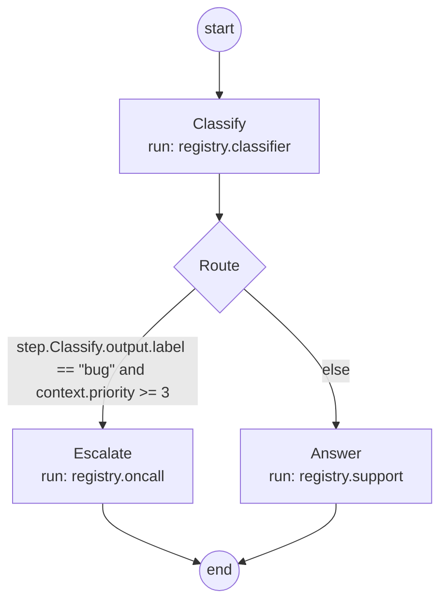

# The .skye language

This page gives you an overview of `.skye`, the one small language Skye uses for routers, prompts and flows: why it exists, what its
blocks look like, and the commands that check, format and draw a file. The full grammar is in the
[.skye language reference](../reference/skye-language.md).

## Why one language

A router, a prompt and a flow are all configuration a person reads and a model often writes. Skye uses one language for the three
instead of JSON for one, YAML for another and Jinja templates for the third:

- **One syntax to learn.** Blocks, attributes, lists, maps and comments work the same everywhere. It reads like HCL.
- **Checked before anything runs.** `skye check` reports every mistake of a file at once, each with the file, line, column, reason
  and fix, in a form you can paste back to a model.
- **Safe expressions.** Conditions and interpolation are parsed with `ast` and checked against a short list of operators and
  functions. Nothing is ever passed to `eval` or `exec`.
- **No extra dependency.** The parser is written in the standard library and lives in `base`. It takes text, never a path, so
  reading the file stays outside the core. Skye reads no YAML.
- **Secrets stay out.** A key is written `env.OPENAI_API_KEY` and read from the environment when the file loads.

A file holds one or more blocks, in any order. A file is self-sufficient unless it takes parts of other files: `include` and `use` insert what several prompts repeat from a partial file (see [Include and partial files](../reference/skye-language.md#include-and-partial-files)).

## The blocks

| Block | What it describes | Read by | State |
|---|---|---|---|
| `router` | routes, targets, strategies, fallbacks, retry and cooldown policies | `ModelRouter.from_file` | released |
| `prompt` | variables, messages, conditions, loops and the shape of the answer | the prompts component | released |
| `flow` | steps, choices, parallel branches, bounded loops, retries, timeouts | `Flow.from_file` | checked and loaded; running is [planned](../project/roadmap.md) |

### router

A router names routes. Each route lists its targets; the shorthand makes the first target the primary and the rest its fallbacks.

```skye
router "support" {
  strategy = "round_robin"
  cooldown = "60s"

  route "fast"   = ["openai/gpt-4o-mini", "anthropic/claude-haiku"]
  route "strong" {
    fallback = ["fast"]
    target {
      model    = "gpt-4o"
      provider = "openai"
      api_key  = env.OPENAI_API_KEY
      rpm      = 500
    }
  }
}
```

Durations are strings with a unit (`"60s"`, `"5m"`). `fallback` names other routes, tried in order when this one fails.

### prompt

A prompt declares its variables with types, then its messages. `when` and `each` replace template tags, and an `output` block
turns a declaration into the instructions the model receives.

```skye
prompt "summarize" {
  variables = {
    text      = string        "The text to summarize"
    max_words = number(100)   "Upper bound on the length"
  }

  message "system" { text = "You write short, faithful summaries." }
  message "user" {
    text = "Summarize in at most {{ max_words }} words:\n{{ text }}"
  }

  output "json" {
    summary  = string         "The summary"
    keywords = list(string)   "Three to five keywords"
  }
}
```

### flow

A flow is a graph of steps. Every step says where to go `next`; a loop needs `max_visits`, so a flow that could run forever does not
load. A step runs a unit by name, `registry.NAME`, that you pass when you load the flow.

```skye
flow "triage" {
  context { ticket = string, priority = number(0) }

  step "Classify" {
    run   = registry.classifier
    input = { text = context.ticket }
    next  = "Route"
  }

  choice "Route" {
    when step.Classify.output.label == "bug" and context.priority >= 3 { next = "Escalate" }
    else                                                                { next = "Answer" }
  }

  step "Escalate" { run = registry.oncall, next = end }
  step "Answer"   { run = registry.support, next = end }
}
```

## Check, format, draw

Three commands work on any `.skye` file:

```bash
skye check app.skye                          # every mistake as file:line:column message; exit 1 if any
skye fmt app.skye                            # rewrite in the standard layout; comments and strings are kept
skye render app.skye --name triage --stdout  # the flow or router as a Mermaid diagram
```

`skye check --format json -` serves editors, `skye fmt --check` serves CI, and `skye new flow my_flow` prints a starting file that
already passes the check. The flow above, drawn by `skye render`, looks like this:



From Python, the same tools are public in `skye.dsl`: `check_text`, `format_text` and `to_mermaid`. `skye.load(path)` reads a file
and returns every block, and raises `ConfigurationError` listing every mistake.

```python
from skye.dsl import check_text

for diagnostic in check_text('router "main" { route "fast" = ["openai/gpt-4o-mini"] }', "inline.skye"):
    print(diagnostic.format())
```

## Editors

A VS Code extension ships inside the package: highlighting, live diagnostics from `skye check` and "Format Document" through
`skye fmt`. Install it with `skye vscode install`. See [Editor support](../reference/editor.md).

## See also

- [.skye language reference](../reference/skye-language.md): grammar, every field, references, expressions, limits and errors.
- [CLI reference](../reference/cli.md): every `skye` command and its exit codes.
- [skye.dsl](../reference/api/dsl.md): the Python functions.
- [First .skye file](../get-started/first-skye-file.md): a guided start.
