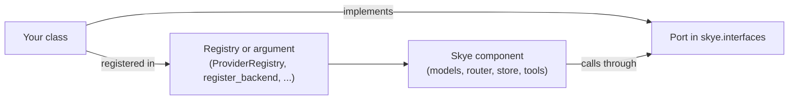

# Extend Skye

This page tells you which Port to implement for what you want to add, and where to plug your implementation in.

A Port is a contract in [`skye.interfaces`](../../reference/api/interfaces.md): an `...Interface` class, or a name without the suffix
such as `Runnable`, `DecisionModel` or `StorageBackend`. You implement the Port, register the implementation where the table says, and
the rest of Skye uses it without knowing it is yours. You never edit Skye to add one.

## How to read the table

- **Kind**: what the name is for. A *data* row is a type a Port uses, not something to implement.
- **Where to plug it in**: the registry or the argument that takes your implementation.
- **Status**: *implemented* when Skye ships an implementation or a released component calls the Port; *Port only* when the contract
  exists but its implementation or its consumer is planned (see [Status and roadmap](../../project/roadmap.md)); *data* for the types.

Every Port documents, in the docstring of its module, what it raises, what it returns when something is missing, and whether it is safe
to call concurrently. A test checks each built-in implementation against the Port's signatures.

## The guides

| You want to add | Guide |
|---|---|
| A model provider (a new API, a gateway, a local server) | [Custom provider](custom-provider.md) |
| A place to keep state | [Custom store backend](custom-store.md) |
| A tool the model can call, or a toolset | [Custom capability](custom-capability.md) |
| A credential source or a secret manager | [Credentials and secrets](../security/credentials.md#your-own-source) |
| A telemetry exporter | [Observability](../observability.md) |

## Every name in `skye.interfaces`

| Name | Kind | Where to plug it in | Example | Status |
|---|---|---|---|---|
| `AuthenticationInterface` | request authenticator (credential source) | `skye.auth.register_credential_source` | `examples/auth/custom_credential_source.py` | implemented |
| `AuthorizerInterface` | authorizer (permit or forbid) | the runtime, by injection (planned `policy`) | `examples/policy/authorizer.py` | Port only |
| `CapabilityContext` | data: what travels with a call besides its arguments | - | - | data |
| `CapabilityInterface` | capability (tool) | a list passed to `complete(capabilities=...)`, or a `skye.tools.CapabilityRegistry` | `examples/tools/registry.py` | implemented |
| `CapabilitySchema` | data: name, description and JSON Schema of a capability | - | - | data |
| `ConfigLoaderInterface` | configuration loader | `skye.config.ConfigLoader` satisfies it by structure | `examples/basic/configuration.py` | implemented |
| `ContentReaderInterface` | document reader | none yet | - | Port only |
| `CostCalculatorInterface` | cost calculator | `skye.models.CostCalculator` is the built-in one | `examples/models/cost_tracking.py` | implemented |
| `CounterStore` | store capability: atomic counter | a store backend (`StorageBackend` includes it) | `examples/store/custom_backend.py` | implemented |
| `Decision` | data: permit or forbid | - | - | data |
| `DecisionModel` | decision model (choose among options) | `skye.models.JevDecisionModel` is the built-in one | `examples/models/decision_model.py` | implemented |
| `DecisionResult` | data: the choice of a decision model | - | - | data |
| `EventHandlerInterface` | lifecycle hooks of a run | the agent loop, by injection (planned) | `examples/observe/custom_exporter.py` | Port only |
| `ExpiryStore` | store capability: is a key alive, and how many seconds it has left | a store backend (every built-in backend has it) | - | implemented |
| `EventType` | data: the names of the observability events | - | - | data |
| `KeyValueStore` | store capability: values by key with expiry | `skye.store.register_backend` | `examples/store/custom_backend.py` | implemented |
| `MemoryEntryLike` | data: the shape of a memory entry | - | - | data |
| `MemoryInterface` | memory | the agent, by injection (planned `memory`) | `examples/memory/custom_memory.py` | Port only |
| `ModelHealthInterface` | router role: failures, cooldown, usage | part of `ModelRouterInterface` | `examples/routing/fallbacks_and_health.py` | implemented |
| `ModelInterface` | model provider | `skye.models.ProviderRegistry.register_model_provider` | `examples/advanced/custom_providers.py` | implemented |
| `ModelRouterInterface` | router: selection, health and configuration together | `skye.router.ModelRouter` is the built-in one | `examples/routing/basic_routing.py` | implemented |
| `ModelSelectionInterface` | router role: register, select, complete | part of `ModelRouterInterface` | `examples/routing/basic_routing.py` | implemented |
| `ObserverInterface` | telemetry exporter: events, metrics, traces | the runtime, by injection (planned `observe`) | `examples/observe/telemetry.py` | Port only |
| `OutputSchema` | data: the output JSON Schema of a prompt | - | - | data |
| `PromptBuilderInterface` | prompt builder: rendering, registry and schema together | `skye.prompts.BasePromptBuilder` is the built-in one | `examples/advanced/prompt_engineering.py` | implemented |
| `PromptParts` | data: a rendered prompt (system text, messages, output schema) | - | - | data |
| `PromptRegistryInterface` | prompt role: templates and defaults | part of `PromptBuilderInterface` | `examples/advanced/prompt_engineering.py` | implemented |
| `PromptRenderingInterface` | prompt role: rendering | part of `PromptBuilderInterface` | `examples/advanced/prompt_engineering.py` | implemented |
| `PromptSchemaInterface` | prompt role: output schema and validation | part of `PromptBuilderInterface` | `examples/advanced/prompt_engineering.py` | implemented |
| `ProviderRegistryInterface` | provider registry | `skye.models.ProviderRegistry` is the built-in one | `examples/advanced/custom_providers.py` | implemented |
| `RegistrarInterface` | registrar: one method per kind of integration, which a plugin calls | the default registrar (planned, `0-base-plugins`) | `examples/plugins/model_provider.py` | Port only |
| `Resource` | data: a resource read by URI | - | - | data |
| `ResourceProviderInterface` | resource source: list, read by URI | every MCP client is one (`skye.tools.create_mcp_client`) | `examples/tools/mcp_prompts_and_resources.py` | implemented |
| `RouterConfigurationInterface` | router role: strategy, fallbacks, policies | part of `ModelRouterInterface` | `examples/routing/basic_routing.py` | implemented |
| `RoutingStrategy` | data: the routing strategies | - | - | data |
| `Runnable` | a unit of work: one request in, one response out | `skye.agents.register_agent_type`, the registry of a `skye.Flow` | `examples/agents/custom_agent_type.py` | implemented |
| `SafetyFilterInterface` | safety filter | the runtime, by injection (planned `guard`) | `examples/guard/safety_filters.py` | Port only |
| `SafetyResult` | data: the outcome of a safety filter | - | - | data |
| `ScanStore` | store capability: keys by prefix | a store backend that can list keys | `examples/store/custom_backend.py` | implemented |
| `StorageBackend` | store backend: key-value plus counter | `skye.store.register_backend` | `examples/store/custom_backend.py` | implemented |
| `TokenCounterInterface` | token counter | `skye.models.TokenCounter` is the built-in one | `examples/models/token_counting.py` | implemented |
| `ToolProvider` | the toolset of an agent: list schemas, run a call | `skye.tools.CapabilityRegistry` is one; the agent loop will take it (planned) | `examples/capabilities/capability_agent.py` | implemented |
| `VectorEncoderInterface` | embedding provider | `skye.models.ProviderRegistry.register_embedding_provider` | `examples/providers/embeddings_example.py` | implemented |

The examples are in the repository, under
[`examples/`](https://github.com/ggiallo28/skye/tree/main/examples); they run offline.

## See also

- [Architecture](../../concepts/architecture.md): the layers and the rule that a component talks to another only through a Port.
- Reference: [`skye.interfaces`](../../reference/api/interfaces.md).
