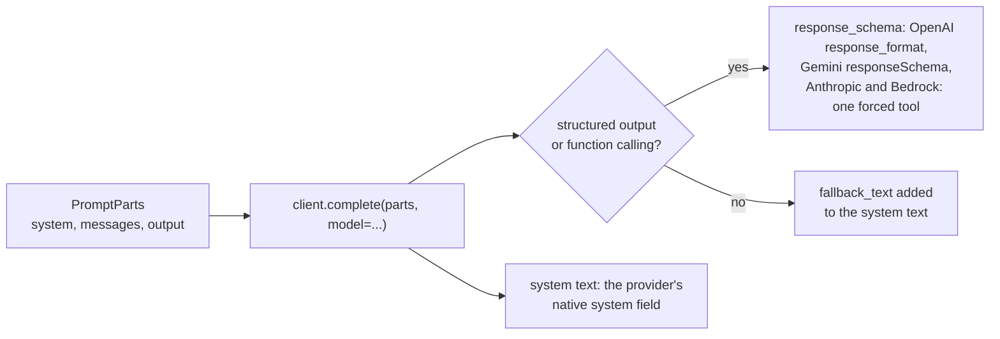

# Output schema

This guide shows you how to declare the shape of the answer a prompt asks for, in an `output` block, and how that shape reaches the
model: as written instructions, or as the provider's native structured-output field.

## What you need

- A prompt in a `.skye` file (see [Write a prompt in .skye](write-a-prompt.md)).
- For the native path (Step 5), a client from `skye.provider(...)`.

## Step 1: write an `output` block

An `output` block lists the fields of the answer with their types; the string after a type is a description for the model. The
label is the format: `"json"` (the default when you leave it out), `"table"`, `"xml"` or `"text"` (a plain answer with no fields, `output "text" { style = "a short paragraph" }`).

```skye
prompt "extract_invoice" {
  variables = { document = string "The invoice text" }

  output "json" {
    vendor   = string         "Seller name as printed on the invoice"
    total    = number         "Total amount including VAT"
    currency = string("EUR")  "ISO 4217 currency code"
    lines    = list({
      description = string  "Text of the line"
      amount      = number  "Amount of the line"
    })                        "One entry per invoice line"
  }

  message "user" { text = "Extract the invoice fields from the document.\n{{ document }}" }
}
```

A field is `string`, `number`, `bool`, `list` or `map`, a list of a type (`list(string)`), a list of objects (`list({ ... })`) or an
object (`{ ... }`). A field with a default (`string("EUR")`) is optional; every other field is required. A `table` takes only
`string`, `number` and `bool` columns.

## Step 2: render it

`render_prompt` writes the instructions for you and appends them to the last user message. For `json` they ask for a single JSON
object, give its JSON Schema (with your descriptions) and a one-line example; for `table`, the header row and the type of each column;
for `xml`, a skeleton whose root element is the prompt name. `output_instructions(spec, variables)` returns the same text alone.

The format can come from a variable: `output format { ... }` reads the declared string variable `format` at render time.

```skye
--8<-- "examples/prompts/output_schema.skye"
```

```python
--8<-- "examples/prompts/output_schema.py"
```

The second half of the example gives the prompt `invoice`, which has no `output` block, a schema from a dataclass with
`builder.set_output_schema("invoice", Invoice, output_format="table")`; `builder.get_output_instructions("invoice")` returns its
instructions. A JSON Schema dictionary works there too.

## Step 3: take the fields from data

When the caller decides the fields, write `schema = VAR`: the fields come from the declared `map` variable `VAR`, which maps each
field name to a type (`"string"`, `"number"`, `"bool"`, `"list"`, `"map"`), a list (`["string"]`), a nested map, or a described
field (`{"type": "number", "description": "With VAT"}`).

```skye
prompt "extract" {
  variables = {
    document = string          "The text to read"
    fields   = map             "Field name to type"
    style    = string("json")  "json, table or xml"
  }
  output style { schema = fields }
  message "user" { text = "{{ document }}" }
}
```

```python
messages = render_prompt(spec, {
    "document": "Lamp 24.90, in stock",
    "fields": {"name": "string", "price": {"type": "number", "description": "Unit price in euro"}},
})
```

## Step 4: choose the shape with a condition

An `output` block may sit inside a `when` at the top of the prompt, so a variable chooses the shape. At render time the block whose
conditions hold applies; none means free text. Write conditions that exclude each other: two active blocks raise `ValidationError`.

```skye
prompt "extract_any" {
  variables = {
    document = string   "The text to read"
    schema   = map({})  "Field name to type; empty for name and value pairs"
  }
  when schema     { output "json" { schema = schema } }
  when not schema {
    output "json" {
      name  = string "What the extracted item is"
      value = string "Its value, as written in the input"
    }
  }
  message "user" { text = "{{ document }}" }
}
```

`active_output(spec, variables)` returns the block that applies, or `None`. `skye prompt info` shows each block under its condition.
The bundled prompt `extraction_structured` is built this way: its `format` variable is `"json"` by default, `"table"` or `"xml"`.

## Step 5: send the schema as a native field

Written instructions work with every model. Most providers can also hold the model to a JSON Schema natively, which is more reliable.
For that, render the prompt with `render_parts` instead of `render_prompt`: it returns a `PromptParts` with the system text, the
messages, the JSON Schema of the `output` block as an `OutputSchema`, and the instructions as `fallback_text` (they are not also
appended to the last user message). The client decides from what the model supports (`get_model_info()`) where each part goes:



```python
import os
from pathlib import Path

import skye
from skye.prompts import load_prompt, render_parts

spec = load_prompt(Path("output_schema.skye").read_text(encoding="utf-8"), "products")
parts = render_parts(spec, {"catalogue": "Desk lamp 24.90, in stock; Chair 89.00, sold out."})
print(parts.output.name, parts.output.schema["required"])   # products ['name', 'price', 'in_stock']

client = skye.provider("openai", api_key=os.environ["OPENAI_API_KEY"])
response = client.complete(parts, model="gpt-4o-mini")
print(response.structured_output)   # {"name": "Desk lamp", "price": 24.9, "in_stock": true}
```

`PromptParts.messages` holds the conversation without the system text, which goes in `system`. Only a `json` output gives an
`OutputSchema`; with `table` or `xml`, `output` is `None` and the instructions travel as `fallback_text`. A prompt without an
`output` block gives neither. `output_json_schema(spec, variables)` returns the JSON Schema of the active block alone.
`client.request_from_parts(parts, model=...)` returns the `CompleteRequest` without sending it, to see what the model would
receive. A router does not take `PromptParts`: pick the model first.

On a `BasePromptBuilder`, `builder.render_parts(name, variables)` does the same for a registered template: the schema comes from
`set_output_schema` (a dataclass or a JSON Schema) or from the `output` block, and is named after the template. You can also build a
`PromptParts` by hand (`from skye.prompts import OutputSchema, PromptParts`, also in `skye.interfaces`).

To pass a dataclass as the schema of one call, without a prompt, see [Structured output](../models/structured-output.md).

## What you get

The shape of the answer is declared once, next to the prompt; the model receives it as instructions it can read or as a native
schema it is held to, and you never write the format by hand in the text.

## See also

- [Structured output](../models/structured-output.md) for `response_schema` and the parsed answer
- [The output block in the .skye language reference](../../reference/skye-language.md#the-output-block-the-shape-of-the-answer)
- [`skye.prompts`](../../reference/api/prompts.md) and [`skye.interfaces`](../../reference/api/interfaces.md) API reference
- Example: [output_schema.py](https://github.com/ggiallo28/skye/blob/main/examples/prompts/output_schema.py) with
  [output_schema.skye](https://github.com/ggiallo28/skye/blob/main/examples/prompts/output_schema.skye)
