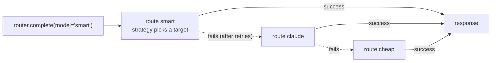

# Aliases and fallbacks

This guide shows you how to call models through a name of your own (an alias), spread an alias over several targets, and fall back
to other models when a call fails.

## What you need

- `pip install skyeai`. The router is part of the base install; it needs no extra.
- An API key for each provider you route to, in its usual environment variable (`OPENAI_API_KEY`, `ANTHROPIC_API_KEY`, ...).

A **route** maps an alias to one or more **targets**. A target is one provider and one model, with optional limits and tags. Your
code asks for the alias; the router picks a target with the route's [strategy](strategies.md), and when the call fails it tries the
other targets of the route, then the **fallback chain** of the alias, in order.



## Step 1: the shorthand

The shortest router maps an alias to a list of `provider/model` entries. The first entry is the primary target; each other entry is
a fallback, tried in order.

=== "Python"

    ```python
    from skye import UserMessage
    from skye.router import ModelRouter

    router = ModelRouter({
        "fast": ["openai/gpt-4o-mini", "anthropic/claude-3-5-haiku-latest"],
    })

    response = router.complete(messages=[UserMessage(content="Hello!")], model="fast")
    print(response.content)
    ```

=== ".skye"

    ```skye
    router "main" {
      route "fast" = ["openai/gpt-4o-mini", "anthropic/claude-3-5-haiku-latest"]
    }
    ```

The API key of each entry comes from the provider's standard environment variable. In a `.skye` file an entry may also be a map,
when one target needs its own key or limits:

```skye
router "main" {
  route "fast" = [
    { model = "openai/gpt-4o-mini", api_key = env.OPENAI_API_KEY, rpm = 60, tpm = 90000 },
    "anthropic/claude-3-5-haiku-latest",
  ]
}
```

The shorthand builds the same objects as the full form below: the alias `fast` gets the first entry, and every other entry becomes
a route named `fast/fallback1`, `fast/fallback2`, ... chained as the fallbacks of `fast`.

## Step 2: the full form

Write the routes in full when you want several targets behind one alias, limits, tags or a strategy per route. In Python you build
[`RouteConfig`](../../reference/api/router.md) and [`ModelTarget`](../../reference/api/router.md) objects; in a `.skye` file you write
`route` and `target` blocks.

=== "Python"

    ```python
    import os

    from skye.router import ModelRouter, ModelTarget, RouteConfig, RoutingStrategy

    router = ModelRouter(routes=[
        RouteConfig(
            alias="smart",
            strategy=RoutingStrategy.ROUND_ROBIN,
            targets=[
                ModelTarget(model="gpt-4o", provider="openai", api_key=os.getenv("OPENAI_API_KEY"), rpm=500, tags=["premium"]),
                ModelTarget(model="gpt-4o", provider="azure", api_key="${AZURE_OPENAI_API_KEY}",
                            api_base="${AZURE_API_BASE}", api_version="2024-02-15-preview", rpm=300, tags=["premium"]),
            ],
        ),
        RouteConfig(
            alias="cheap",
            targets=[ModelTarget(model="gpt-4o-mini", provider="openai", api_key="${OPENAI_API_KEY}", tags=["fast"])],
        ),
    ])
    ```

=== ".skye"

    ```skye
    router "main" {
      route "smart" {
        strategy = "round_robin"
        target {
          model    = "gpt-4o"
          provider = "openai"
          api_key  = env.OPENAI_API_KEY
          rpm      = 500
          tags     = ["premium"]
        }
        target {
          model       = "gpt-4o"
          provider    = "azure"
          api_key     = env.AZURE_OPENAI_API_KEY
          api_base    = env.AZURE_API_BASE
          api_version = "2024-02-15-preview"
          rpm         = 300
          tags        = ["premium"]
        }
      }
      route "cheap" {
        target { model = "gpt-4o-mini", provider = "openai", tags = ["fast"] }
      }
    }
    ```

A string field of `ModelTarget` written as `${NAME}` is replaced by the environment variable `NAME` (a missing variable is a
`ConfigurationError`); in `.skye` you write `env.NAME`. A `.skye` target with no `api_key` takes the provider's standard variable
(`OPENAI_API_KEY`, `ANTHROPIC_API_KEY`, ...) when it is set; in Python, pass `api_key` yourself. The fields of a target:

| Field | Meaning |
|---|---|
| `model`, `provider` | The model identifier and the provider name (`openai`, `azure`, `anthropic`, `bedrock`, `google`, ...). Required. |
| `api_key`, `api_base`, `api_version`, `region`, `timeout` | Passed to the provider when the router creates it (for `azure`, `api_base` is the endpoint and `model` the deployment name). |
| `options` | Keyword arguments passed as they are to the provider client, for what it needs and the target has no field for (below). |
| `tpm`, `rpm` | Tokens and requests per minute; see [Health and cooldown](health-and-cooldown.md). |
| `weight`, `cost_per_1k_prompt_tokens`, `cost_per_1k_completion_tokens` | Read by the `weighted` and `cost_based` [strategies](strategies.md). |
| `tags` | Labels for tag-based selection (below). |
| `max_retries` | Retries of this target; replaces the count of the retry policy for the error types the policy retries (Step 4). |
| `metadata` | Kept with the configuration; the router does not read it. |

Some providers need settings that are not target fields: Google needs a `project_id` and a `location`, and an Azure deployment may
need a `deployment_name` that differs from `model`. Pass them in `options`; the router hands them to the provider client after the
fields above, so an option wins over a field of the same name. A string written `${NAME}` is replaced by the variable, as for the
fields, and exported back as `${NAME}`.

=== "Python"

    ```python
    from skye.router import ModelTarget

    gemini = ModelTarget(
        model="gemini-2.0-flash",
        provider="google",
        options={"project_id": "${GOOGLE_CLOUD_PROJECT}", "location": "europe-west1"},
    )
    ```

=== ".skye"

    ```skye
    router "app" {
      route "gemini" {
        target {
          model    = "gemini-2.0-flash"
          provider = "google"
          options  = { project_id = env.GOOGLE_CLOUD_PROJECT, location = "europe-west1" }
        }
      }
    }
    ```

Each target gets a **model id** `alias:provider:model` (`smart:openai:gpt-4o`). You use it to read the health of one target and to
see which target served a request.

Load a `.skye` router with `ModelRouter.from_file`. Keyword arguments are those of `ModelRouter` (all but `routes`):
`strategy`, `cooldown_seconds` and `enable_pre_call_checks` override what the file says; `fallbacks`, `retry_policies` and
`allowed_fails_policies` are added after the file's, so they win for the same primary or error type; `storage` and `sleep` are
passed on. A keyword that is none of these raises `ConfigurationError` with the accepted names, so a typo is not ignored.

```python
import skye.store
from skye.router import ModelRouter

router = ModelRouter.from_file("router.skye", name="main")
router = ModelRouter.from_file("router.skye", name="main", cooldown_seconds=120.0)
router = ModelRouter.from_file("router.skye", name="main", storage=skye.backend("dynamodb", table_name="skye-router"))
```

`from_file` also reads a JSON file with the same content as `ModelRouter.from_config_dict`, which takes the same keyword
arguments. It refuses YAML with a `ConfigurationError`.

## Step 3: fallback chains

A fallback chain lists the routes to try, in order, when the alias fails. Each entry is an alias (the router picks one of its
targets with that route's strategy) or a model id.

=== "Python"

    ```python
    from skye.router import FallbackConfig, ModelRouter

    router = ModelRouter(
        routes=[...],  # the routes "smart", "claude" and "cheap"
        fallbacks=[FallbackConfig(primary="smart", fallbacks=["claude", "cheap"])],
    )
    ```

=== ".skye"

    ```skye
    router "main" {
      route "smart" {
        fallback = ["claude", "cheap"]   # if smart fails, try claude, then cheap
        target { model = "gpt-4o", provider = "openai" }
      }
      route "claude" {
        target { model = "claude-3-5-sonnet-latest", provider = "anthropic" }
      }
      route "cheap" {
        target { model = "gpt-4o-mini", provider = "openai" }
      }
    }
    ```

When you call `router.complete(model="smart")`:

1. The strategy of `smart` picks one available target (not in cooldown, under its rate limits).
2. The router calls it, retrying as the retry policy allows for the error.
3. If it still fails, the strategy picks another available target of `smart` that has not failed yet, and the router goes back to 2.
   A route with `fallback_on_error = false` skips this step.
4. When no target of `smart` is left, the router takes the next entry of the chain and starts again from 1 with that route.
5. If every entry fails, `ProviderError` names what was tried and chains the last error.

A route with no available target at all (every one in cooldown or over its `rpm`) goes straight to its chain. Only when nothing
in the chain is available either does `complete` raise the `ProviderError` that says so (`No available targets for alias ...`).
You can change the chains later with `router.set_fallbacks([...])`.

!!! tip "Draw the chain"
    `skye render router.skye --stdout` prints a Mermaid diagram of the routes and their fallbacks. See the
    [CLI reference](../../reference/cli.md).

## Step 4: retries

A retry policy says how many times the router calls the same target again for an error type, and how long it waits first. The error
type is the name of an error class. The provider adapters raise these subclasses of `ProviderError` (all in `skye.exceptions`):

| Error class | When |
|---|---|
| `RateLimitError` | HTTP 429: a rate limit or a quota |
| `ServerError` | HTTP 5xx |
| `ProviderTimeoutError` | a timeout or a dropped connection (no status code) |
| `AuthenticationError` | HTTP 401 or 403 |
| `BadRequestError` | any other HTTP 4xx |
| `ContentPolicyError` | a `BadRequestError` the provider refused under its content policy |

A name matches its class and every subclass, the most specific name first: a policy on `ProviderError` covers every provider error,
one on `BadRequestError` covers `ContentPolicyError` too. No match means no retry. The defaults are `RateLimitError` 3,
`ServerError` 2, `ProviderTimeoutError` 2 and `AuthenticationError` 0; a policy you write replaces the default of its error type only.

=== "Python"

    ```python
    from skye.router import ModelRouter, RetryPolicyConfig

    router = ModelRouter(
        routes=[...],
        retry_policies=[
            RetryPolicyConfig(error_type="RateLimitError", max_retries=3, retry_after_seconds=1.0, exponential_backoff=True),
            RetryPolicyConfig(error_type="ProviderTimeoutError", max_retries=1),
        ],
    )
    ```

=== ".skye"

    ```skye
    router "main" {
      route "smart" = ["openai/gpt-4o", "openai/gpt-4o-mini"]

      retry_policy "RateLimitError"       { max_retries = 3, retry_after = "1s", exponential_backoff = true }
      retry_policy "ProviderTimeoutError" { max_retries = 1 }
    }
    ```

The wait before each retry:

- `retry_after_seconds` (`retry_after = "1s"` in `.skye`) is the wait before the first retry; with no value the retry is at once.
- `exponential_backoff` doubles it after each retry: 1 s, 2 s, 4 s in the example.
- When the provider says how long to wait (its `Retry-After` header, kept as `error.retry_after`) and that is longer, the router
  waits that long instead. When it is longer than the router's cooldown (`cooldown_seconds`), the router does not wait: it moves to
  the next target.
- A target's own `max_retries` replaces the policy's count for that target, for the error types the policy retries; an error type
  the policy does not retry (such as `AuthenticationError`) is never retried.

A waiting request is not counted as an active one. In tests, pass `ModelRouter(sleep=...)` an async function that records the waits
instead of sleeping.

!!! note "The client's own retries are off"
    A provider client used alone retries rate limits, server errors and timeouts by itself. Inside a router the router
    turns those retries off on every client it creates (and on a model you register that has a `max_retries` attribute), so a failing
    target is not retried twice and a fallback does not first wait out the client's backoff. The router's policy decides.

## Step 5: select by tags

Instead of an alias, ask for tags. The router keeps the targets that have every tag and picks one with the router's strategy. With
both an alias and tags, it picks among the targets of the alias that have the tags.

```python
from skye import UserMessage

messages = [UserMessage(content="Summarize this ticket.")]
response = router.complete(messages=messages, tags=["fast"])
response = router.complete(messages=messages, model="smart", tags=["premium"])
```

`router.acomplete(...)` takes the same arguments in async code. With neither `model` nor `tags`, `complete` raises `ValueError`.

## What you get

Every response carries a serving record in `response.metadata["router"]`, also kept as `router.last_serving`. It never holds a key:

```python
record = response.metadata["router"]
print(record["model_id"])         # "smart:openai:gpt-4o"
print(record["fallback"])         # True when a fallback answered
print(record["tried"])            # the targets that failed first
print(record["total_attempts"])   # calls across the whole chain
```

You can inspect and export the configuration too: `router.list_aliases()`, `router.get_route("smart")`, `router.is_alias(name)`,
`router.to_config()` (a dictionary for `from_config_dict`) and `router.to_skye("main")` (a `.skye` text that passes `skye check`).
Both exports write keys as `${NAME}` or `env.NAME` and leave out keys given in clear, unless you pass `include_secrets=True`.

## A runnable example

This example loads [`router_config.skye`](https://github.com/ggiallo28/skye/blob/main/examples/routing/router_config.skye), overrides
two settings and writes the router back as `.skye`. It makes no request.

```python
--8<-- "examples/routing/skye_config_example.py"
```

## See also

- [Strategies](strategies.md), [Health and cooldown](health-and-cooldown.md), [Router state in a store](router-state.md)
- [`skye.router` API reference](../../reference/api/router.md) and the [`router` block of the .skye language](../../reference/skye-language.md#router)
- Examples: [basic_routing.py](https://github.com/ggiallo28/skye/blob/main/examples/routing/basic_routing.py),
  [fallbacks_and_health.py](https://github.com/ggiallo28/skye/blob/main/examples/routing/fallbacks_and_health.py),
  [skye_config_example.py](https://github.com/ggiallo28/skye/blob/main/examples/routing/skye_config_example.py) and
  [router_config.skye](https://github.com/ggiallo28/skye/blob/main/examples/routing/router_config.skye)
