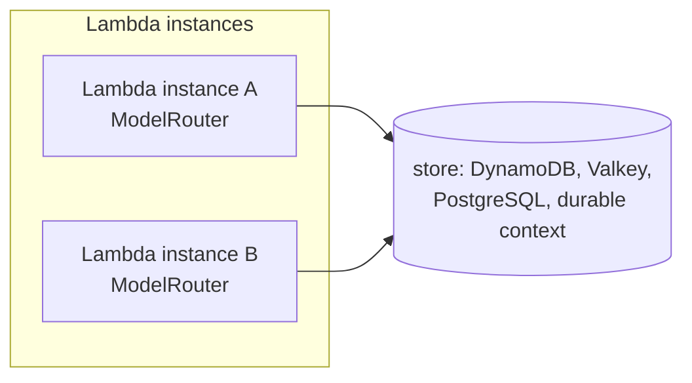

# Router state in a store

This guide shows you how to keep the router's health, cooldown and rate-limit figures across serverless invocations, by giving the
router a store backend.

## Why the default is not enough in Lambda

By default the router keeps its state in memory (`InMemoryBackend`). That is right for a long-lived process: a container, or a
Lambda function whose warm process serves many requests. It is wrong when each invocation may start a new process: the cooldown of
a failing target, the requests of the current minute and the latencies are lost, and every new process starts by calling the target
that just failed. Skye never picks a durable store for you; you choose one and pass it as `storage=`.



## What you need

- A store reachable from the function, and the extra of its driver if any:

| Backend | Name in `skye.backend` | Install | Fits |
|---|---|---|---|
| In memory (default) | `memory` | nothing | a warm process, tests |
| DynamoDB | `dynamodb` | nothing in Lambda (boto3 is there); `pip install skyeai[aws]` elsewhere | AWS Lambda, no server to run |
| Valkey or Redis | `valkey`, `redis` | `pip install skyeai[valkey]` or `pip install skyeai[redis]` | low latency, ElastiCache |
| PostgreSQL | `postgres` | nothing for the Aurora Data API in Lambda; `pip install skyeai[postgres]` (pg8000) or `pip install skyeai[postgres-asyncpg]` | a database you already run |
| Lambda durable function | `durable_function` | nothing | a durable function: state of one execution |
| Files | `file` | nothing | local development |

[Choose a store backend](../state/choose-a-backend.md) compares them in detail.

## Step 1: build the backend

`skye.backend(name, **config)` builds a backend by name (`skye.store.backend` is the same function); you can also import its class from `skye.store`. Nothing connects
until the first operation, so building one needs no network.

=== "DynamoDB"

    ```python
    from skye.store import backend

    store = backend("dynamodb", table_name="skye-router", region_name="eu-west-1")
    ```

    The table needs a string partition key `pk`. Enable `ttl` as its TTL attribute so DynamoDB deletes expired items; the backend
    also ignores an expired item on read. Without `region_name`, the region comes from the AWS configuration (`AWS_REGION` in Lambda).

=== "Valkey / Redis"

    ```python
    from skye.store import backend

    store = backend("valkey", redis_url="rediss://my-cache.example.com:6379/0", key_prefix="myapp:")
    ```

    `valkey` and `redis` are two names for one backend, `RedisBackend`. It uses the `valkey` driver when installed, else `redis`.

=== "PostgreSQL"

    ```python
    from skye.store import backend

    # Aurora with the RDS Data API: HTTP calls, no connection to manage
    store = backend(
        "postgres",
        cluster_arn="arn:aws:rds:eu-west-1:123456789012:cluster:app",
        secret_arn="arn:aws:secretsmanager:eu-west-1:123456789012:secret:app-db",
        database="app",
    )

    # Any PostgreSQL, with pg8000 or asyncpg installed
    store = backend("postgres", connection_string="postgresql://app@db.example.com/app")
    ```

    The table (`skye_storage` by default, `table_name=` to change it) is created on first use.

=== "Durable function"

    ```python
    from skye.store import backend

    def handler(event, context):
        store = backend("durable_function", context=context)
        ...
    ```

    `context` is the durable context of the execution: any object with `get_state(name)` and `set_state(name, value)`. The state
    lasts for one execution of the durable function, so build the router inside the handler.

## Step 2: give it to the router

Pass the backend as `storage=` when you build the router. Build the router once, at module level, so a warm process reuses it;
the router connects to the store at its first request.

```python
from skye import UserMessage
from skye.router import AllowedFailsPolicyConfig, ModelRouter
from skye.store import backend

router = ModelRouter(
    {"chat": ["openai/gpt-4o-mini", "anthropic/claude-3-5-haiku-latest"]},
    allowed_fails_policies=[AllowedFailsPolicyConfig(error_type="ProviderError", allowed_fails_per_minute=3)],
    storage=backend("dynamodb", table_name="skye-router"),
)


def handler(event, context):
    response = router.complete(messages=[UserMessage(content=event["question"])], model="chat")
    return {"answer": response.content, "served_by": response.metadata["router"]["model_id"]}
```

Every instance that uses the same store and the same routes now shares the figures: a target that one instance put in cooldown is
skipped by the others, and the `rpm` and `tpm` counters add up across instances.

A router read from a file takes the store the same way:

```python
from skye.router import ModelRouter
from skye.store import backend

router = ModelRouter.from_file("router.skye", name="main", storage=backend("dynamodb", table_name="skye-router"))
```

`ModelRouter.from_config_dict` takes `storage=` too. Both reject a keyword argument that `ModelRouter` does not have, so a misspelt
`storge=` raises `ConfigurationError` instead of leaving you with an in-memory router.

## What is stored

The keys name the model id of the target (`alias:provider:model`), and each one starts with `router:`, the namespace the router takes in the store
(`skye.store.namespaced(store, "router")`), so the same store can hold the state of other components. Two routers that use the same store and the
same aliases share these keys, so give separate applications separate tables, prefixes or databases.

| Key | Holds | Expires |
|---|---|---|
| `router:health:<model id>:success`, `...:failure` | the counts of successes and failures | 24 hours after the last update |
| `router:health:<model id>:latency_us` | the total latency of the successes, in microseconds | 24 hours after the last update |
| `router:health:<model id>:reason:<error type>`, `...:reasons` | the failures of one error type, and the error types seen | 24 hours after the last update |
| `router:health:<model id>:last` | the last success and failure times, the lowest and highest latency | 24 hours after the last update |
| `router:cooldown:<model id>` | the end of the cooldown | a minute after the cooldown ends |
| `router:recent_failures:<model id>:<error type>:<second>` | the failures of one second, counted by the allowed-fails policy | 2 minutes |
| `router:rate_limit:<model id>:rpm:<minute>`, `...:tpm:<minute>` | requests and tokens of one minute | 2 minutes |
| `router:active_requests:<model id>` | requests in flight | 1 hour |

Every count (successes, failures, latency totals, the failures of the last minute, the per-minute requests and tokens, the requests
in flight) uses the backend's atomic `increment`, so it is exact across instances. Only `health:<model id>:last` is read and written
back: two instances writing at the same moment can lose a time or an extreme latency, never a count. The figures are meant for
routing decisions, not for billing. The round-robin position stays in each process.

## See also

- [Choose a store backend](../state/choose-a-backend.md)
- [Health and cooldown](health-and-cooldown.md): what the figures mean
- [`skye.store` API reference](../../reference/api/store.md) and [`skye.router` API reference](../../reference/api/router.md)
- Example: [backends.py](https://github.com/ggiallo28/skye/blob/main/examples/store/backends.py), the same calls against each backend
