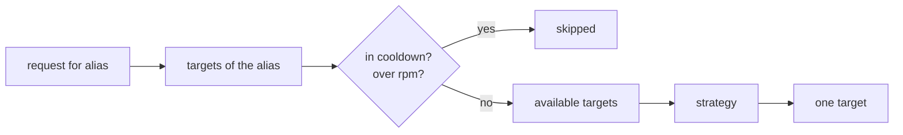

# Strategies

This guide shows you how to choose the routing strategy that picks one target among the targets of an alias, and how to set it in
Python and in a `.skye` router.

## What you need

- A router with at least one alias that has several targets (see [Aliases and fallbacks](aliases-and-fallbacks.md)).
- For `weighted`, a `weight` on the targets; for `cost_based`, their prices; for `rate_limit_aware`, their `tpm` or `rpm`.

## How a target is picked

For each request the router first drops the targets that cannot take it, then lets the strategy choose among the rest:



When no target of the requested alias is available, the router tries the alias's
[fallback chain](aliases-and-fallbacks.md#step-3-fallback-chains); with no chain, or when nothing in it is available either, it raises
`ProviderError` (`No available targets for alias ...`). When the picked target fails, the strategy picks again among the targets of
the route that have not failed yet (unless the route sets `fallback_on_error` to false). Health and cooldown are covered in
[Health and cooldown](health-and-cooldown.md).

## The strategies

Eight strategies are members of [`RoutingStrategy`](../../reference/api/router.md); in `.skye` you write the value as a string.
`lazy_complex` is a ninth, registered by name only (it is not a member).

| Strategy | `.skye` value | Picks | Reads |
|---|---|---|---|
| `ROUND_ROBIN` | `"round_robin"` | Each target in turn | A counter per alias, kept in the process |
| `SIMPLE_SHUFFLE` | `"simple_shuffle"` | A random target | Nothing |
| `LEAST_BUSY` | `"least_busy"` | The target with the fewest requests in flight | The active-request counter |
| `RATE_LIMIT_AWARE` | `"rate_limit_aware"` | The target with the most room left this minute | `tpm`, `rpm` and the usage of the current minute |
| `LATENCY_BASED` | `"latency_based"` | The target with the lowest average latency | The latency of successful calls |
| `COST_BASED` | `"cost_based"` | The cheapest target | `cost_per_1k_prompt_tokens`, `cost_per_1k_completion_tokens` |
| `WEIGHTED` | `"weighted"` | A random target, in proportion to its weight | `weight` (default 1.0) |
| `PRIORITY_BASED` | `"priority_based"` | The target with the highest success rate | Success and failure counts |
| not a member | `"lazy_complex"` | The cheap target for an easy request, the strong one for a hard one | The prompt estimate, tools and a response schema |

How each one breaks ties and treats a target it knows nothing about:

- **`rate_limit_aware`**: the room of a target is `1 - used / limit` for `rpm` and for `tpm`, the smaller of the two; a target with
  no limit counts as empty (room 1.0).
- **`latency_based`**: a target that has not answered yet has no latency and comes after every target that has one. Ties keep the
  configured order.
- **`priority_based`**: a target with no calls yet counts as 100% successful. Ties keep the configured order, so the first target is
  the primary until it starts failing.
- **`cost_based`**: the router estimates the tokens of the request (about four characters per token for the prompt; `max_tokens`,
  or the prompt estimate, for the completion) and weights each price by them. A price left out counts as 0; a target with neither
  price comes after every priced target; ties keep the configured order. Use one currency for every target.
- **`weighted`**: with every weight at 0, the pick is uniform.
- **`lazy_complex`**: see [Choose by how hard the request is](#choose-by-how-hard-the-request-is).

The usage, latency and success figures come from the router's store, so with a shared store (see
[Router state in a store](router-state.md)) every instance sees the same figures. The round-robin counter stays in each process.

## Set the strategy of a route

Each alias can have its own strategy; a route that sets none uses the router's (next section).

=== "Python"

    ```python
    from skye.router import ModelRouter, ModelTarget, RouteConfig, RoutingStrategy

    router = ModelRouter(routes=[
        RouteConfig(
            alias="canary",
            strategy=RoutingStrategy.WEIGHTED,
            targets=[
                ModelTarget(model="gpt-4o", provider="openai", api_key="${OPENAI_API_KEY}", weight=80),
                ModelTarget(model="gpt-4.1", provider="openai", api_key="${OPENAI_API_KEY}", weight=20),
            ],
        ),
        RouteConfig(
            alias="budget",
            strategy=RoutingStrategy.COST_BASED,
            targets=[
                ModelTarget(model="gpt-4o-mini", provider="openai", api_key="${OPENAI_API_KEY}",
                            cost_per_1k_prompt_tokens=0.00015, cost_per_1k_completion_tokens=0.0006),
                ModelTarget(model="gpt-4o", provider="openai", api_key="${OPENAI_API_KEY}",
                            cost_per_1k_prompt_tokens=0.0025, cost_per_1k_completion_tokens=0.01),
            ],
        ),
    ])
    ```

=== ".skye"

    ```skye
    router "main" {
      route "canary" {
        strategy = "weighted"
        target { model = "gpt-4o",  provider = "openai", weight = 80 }
        target { model = "gpt-4.1", provider = "openai", weight = 20 }
      }
      route "budget" {
        strategy = "cost_based"
        target { model = "gpt-4o-mini", provider = "openai", cost_per_1k_prompt_tokens = 0.00015, cost_per_1k_completion_tokens = 0.0006 }
        target { model = "gpt-4o", provider = "openai", cost_per_1k_prompt_tokens = 0.0025, cost_per_1k_completion_tokens = 0.01 }
      }
    }
    ```

## Set a default strategy

A router sets `strategy` once, at the top of a `.skye` router or with `ModelRouter(strategy=...)` in Python; every route without its
own takes it (`round_robin` when the router sets none). `ModelRouter.from_file` also takes `strategy=` to override the file.

```skye
router "main" {
  strategy = "rate_limit_aware"   # the default of every route below

  route "chat" {
    target { model = "gpt-4o-mini", provider = "openai", rpm = 2000, tpm = 200000 }
    target { model = "gpt-4o-mini", provider = "azure", api_key = env.AZURE_OPENAI_API_KEY, api_base = env.AZURE_API_BASE, rpm = 1000 }
  }
  route "reasoning" {
    strategy = "latency_based"    # this route keeps its own
    target { model = "o3-mini", provider = "openai" }
  }
}
```

In Python, `RouteConfig.strategy` defaults to `None`, which means "the router's". The `strategy` argument of `ModelRouter` (and
`router.set_routing_strategy(...)`, which changes it later) applies to every such route, and to requests that do not name an alias:
models added with `router.register_model(...)` and tag-only requests (`router.complete(messages=..., tags=["fast"])`).

```python
from skye.router import ModelRouter, ModelTarget, RouteConfig, RoutingStrategy

router = ModelRouter(
    routes=[RouteConfig(alias="chat", targets=[
        ModelTarget(model="gpt-4o-mini", provider="openai", api_key="${OPENAI_API_KEY}"),
        ModelTarget(model="gpt-4o-mini", provider="azure", api_key="${AZURE_OPENAI_API_KEY}", api_base="${AZURE_API_BASE}"),
    ])],
    strategy=RoutingStrategy.LEAST_BUSY,   # "chat" sets no strategy: it uses least_busy
)
router.set_routing_strategy(RoutingStrategy.LATENCY_BASED)   # now "chat" uses latency_based
```

`router.to_config()` and `router.to_skye()` write a route's strategy only when it differs from the router's.

## Choose by how hard the request is

`lazy_complex` is a first, deliberately naive strategy. Order the targets of the route from the cheap model (first) to the strong one (last).
It gives each request a level from 0 to 2, **+1** when the prompt is long (more than 800 estimated tokens) and **+1** when the request asks
for tools or for a structured answer, and takes the target at that level: with two targets level 0 is the first and levels 1 and 2 are the
last; with three, the first, the middle and the last; with one target, that one. It does not read the content of the request, the history or
the figures of the router, and it is meant to be improved.

```skye
router "main" {
  route "smart" {
    strategy = "lazy_complex"
    target { model = "gpt-4o-mini", provider = "openai" }   # the cheap one, first
    target { model = "o3", provider = "openai" }            # the strong one, last
  }
}
```

### Write a strategy that reads the request

A strategy that is a plain function gets the ids of the models. A function marked with `with_context` gets one read-only
`StrategyContext` instead: the models in the order of the route, the alias, the token estimate, the request (`messages`, `capabilities`,
`response_schema`, `max_tokens`, `tags`), the metrics of each model and its target. Register it by name, like any strategy:

```python
from skye.plugins import Plugins
from skye.router import StrategyContext, with_context

plugins = Plugins()


@plugins.routing_strategy("tools-go-strong")
@with_context
def tools_go_strong(context: StrategyContext) -> str:
    wants_tools = context.request is not None and bool(context.request.capabilities)
    return context.models[-1 if wants_tools else 0]
```

The function must return one of `context.models`; any other id raises `ConfigurationError`. The router tells the two kinds of function by the
mark and never by the parameters.

## Which one to use

| You want | Use |
|---|---|
| Spread load evenly over identical deployments | `round_robin` |
| Stay under provider quotas with several keys or regions | `rate_limit_aware` (set `tpm` and `rpm`) |
| Long, uneven requests | `least_busy` |
| The fastest region | `latency_based` |
| A canary or an A/B split | `weighted` |
| The cheapest model that is up | `cost_based` |
| A primary that loses traffic only when it fails | `priority_based` |
| A cheap model for easy requests and a strong one for hard ones | `lazy_complex` |

## See also

- [Aliases and fallbacks](aliases-and-fallbacks.md), [Health and cooldown](health-and-cooldown.md)
- [`skye.router` API reference](../../reference/api/router.md)
- Example: [router_config.skye](https://github.com/ggiallo28/skye/blob/main/examples/routing/router_config.skye), one route per
  strategy
